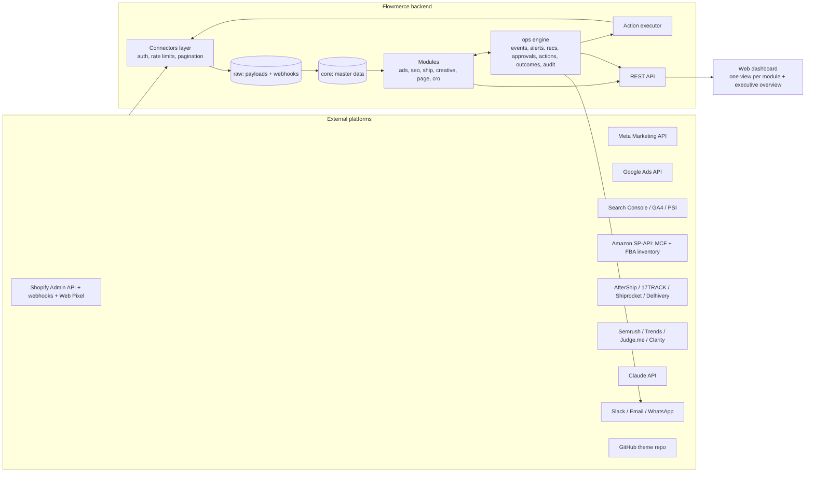
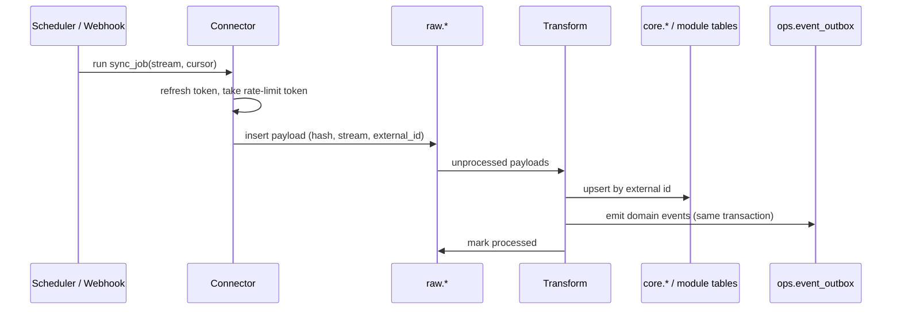
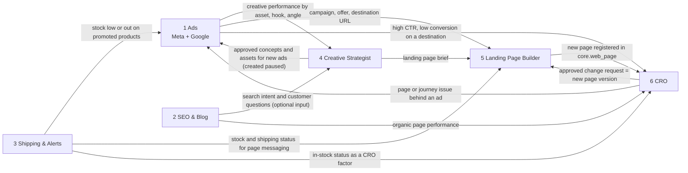
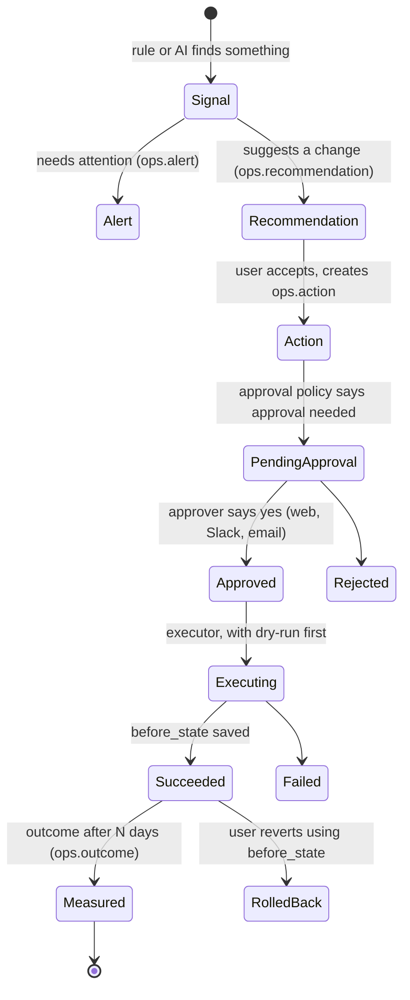

# Flowmerce: platform architecture

Status: planning draft v0.1, 2026-10-28. Owner: Aditya.

Flowmerce is one platform where the business can **track** what is happening, **manage** it, and **act** on it. It has six modules:

| # | Module | Code name | What it owns |
|---|---|---|---|
| 1 | Meta & Google Ads | `ads` | Ad accounts, campaign structure, spend and results, diagnosis, recommendations, approved changes |
| 2 | SEO & Blog Automation | `seo` | Keywords, topics, blog drafts, content scores, Search Console performance, AI-search visibility |
| 3 | Shipping Tracking & Alerts | `ship` | Shipments, tracking events, stuck/late alerts, stock readiness, production shortfalls, Amazon MCF |
| 4 | Creative Strategist | `creative` | Assets, concepts, hooks, briefs, creative tests, trend and competitor references |
| 5 | Landing Page Builder | `page` | Landing pages built from a brief, versions, previews, validation, approved deployment to Shopify |
| 6 | CRO | `cro` | Page funnels, page comparisons, diagnoses, winning patterns, experiments |

Everything they share (products, orders, pages, stock, taxonomy, brand rules) lives once in `core`. Everything that leads to an action (alerts, recommendations, approvals, execution, outcomes, audit) goes through one shared engine, `ops`.

Companion files:
- `docs/02-connectors-and-apis.md`: every external API, what it is used for, auth, sync mode and schedule.
- `docs/03-data-model.md`: master data model, interlinking keys, identity rules, metric definitions.
- `db/schema.sql`: the PostgreSQL schema. It loads cleanly on PostgreSQL 16 and was smoke-tested with sample rows.
- `architecture-map.html`: an interactive map of modules, connectors and data flows.

---

## 1. Design principles

1. **One master copy of shared data.** A product, an order, a page URL or a stock level exists once in `core`. Modules reference it by id; they never keep their own copy.
2. **Modules are independent, links are explicit.** Each module owns its own schema and can be built, shipped and switched off on its own. Cross-module links are foreign keys to `core` or published events, never direct reads of another module's private tables. The exceptions are the read-only cross-module views listed in section 5.
3. **Land raw, then transform.** Every API response and webhook is stored as-is in `raw` first. If a transform is wrong, we fix it and replay; we never re-pull years of data.
4. **Nothing consequential happens without approval.** Ad budget changes, page publishing, theme changes, MCF orders: all are `ops.action` rows that need an approval before the executor runs them. Deletes are forbidden by policy.
5. **AI explains and drafts, code computes.** Numbers, thresholds and scores come from SQL and Python. The LLM (Claude API) writes drafts, briefs and plain-language explanations, and every call is logged in `ops.llm_call`.
6. **Say what we do not know.** Diagnoses carry an evidence level (`observed`, `probable`, `hypothesis`) and a confidence. Estimates are labelled by source (for example, a Semrush volume is an estimate, Google Trends is relative interest).

---

## 2. System overview



---

## 3. Backend structure

### 3.1 Stack

| Layer | Choice | Why |
|---|---|---|
| Language / API | Python 3.12, FastAPI, Pydantic v2 | Best fit for data, ads and AI work; matches the earlier Meta Ads plan |
| Database | PostgreSQL 16 (managed, e.g. Supabase, Cloud SQL or RDS) | One master database; schemas per module; JSONB for raw payloads |
| ORM / migrations | SQLAlchemy 2.0 + Alembic | `db/schema.sql` becomes the first Alembic migration |
| Jobs and schedules | Celery + Redis (workers + beat), or Dramatiq + APScheduler | Sync jobs, rule runs, executor, outcome checks |
| Rate limiting / locks | Redis token buckets per connection | Each API has its own limits |
| Object storage | S3-compatible bucket (S3, R2 or GCS) | Creative files, page code bundles, screenshots |
| Secrets | Cloud secret manager (GCP Secret Manager or AWS Secrets Manager) | `integration.connection.secret_ref` points here |
| Frontend | Next.js (React) + a chart library | One dashboard with a page per module |
| AI | Claude API through one internal `llm` gateway | Prompt versions, structured JSON output, cost logging |
| Browser automation | Playwright (server side) | Page screenshots, mobile checks, link checks for landing pages |
| Observability | Sentry + structured logs + uptime checks | Sync failures and executor errors raise alerts |
| CI/CD | GitHub + GitHub Actions; containers on Cloud Run, Render or Fly | Small team, low ops |

This is a **modular monolith**: one codebase and one database, with hard module boundaries inside. It can be split into services later if a module outgrows it; it does not need microservices on day one.

### 3.2 Repository layout

```text
flowmerce/
├── apps/
│   ├── api/                  FastAPI app: routers mounted per module, auth, webhooks endpoint
│   ├── worker/               Celery worker + beat schedule
│   └── web/                  Next.js dashboard
├── flowmerce/
│   ├── core/                 settings, db session, auth/RBAC, money/time utils
│   │   ├── models/           SQLAlchemy models for core.* (product, order, web_page, ...)
│   │   ├── identity.py       URL normalisation, product identifier matching, UTM parsing
│   │   └── events.py         outbox writer + dispatcher
│   ├── connectors/           one package per provider, no business logic
│   │   ├── base.py           auth refresh, retry/backoff, pagination, rate limiter, raw landing
│   │   ├── shopify/          client.py, queries/*.graphql, webhooks.py, pixel_collector.py
│   │   ├── meta_ads/         insights.py, structure.py, writes.py
│   │   ├── google_ads/       gaql/*.sql, structure.py, writes.py
│   │   ├── gsc/  ga4/  psi/  clarity/
│   │   ├── amazon_spapi/     mcf.py, fba_inventory.py, notifications.py
│   │   ├── aftership/  track17/  shiprocket/  delhivery/
│   │   ├── semrush/  trends/  judgeme/
│   │   ├── github/           theme repo PRs
│   │   ├── messaging/        slack.py, email.py, whatsapp.py
│   │   └── anthropic/        llm gateway client
│   ├── modules/
│   │   ├── ads/              models, transforms, metrics, rules/, recommendations, api.py
│   │   ├── seo/              keyword research, topic scoring, drafting, scoring, api.py
│   │   ├── ship/             tracking normaliser, readiness, MCF, production, alerts, api.py
│   │   ├── creative/         rollups, concept generation, briefs, tests, api.py
│   │   ├── page/             brief parser, section spec, code generator, validator, deployer, api.py
│   │   └── cro/              funnels, peer groups, diagnosis, patterns, experiments, api.py
│   ├── ops/                  alerts, recommendations, approvals, executor, outcomes, audit, notifications
│   └── llm/                  prompt registry (versioned), schemas for structured output, eval sets
├── db/
│   ├── schema.sql            reference DDL (this design)
│   └── migrations/           Alembic
├── config/
│   ├── rules/*.yaml          alert and recommendation thresholds per module
│   └── schedules.yaml        sync and job schedules
└── tests/                    unit, contract tests per connector (recorded responses), rule backtests
```

Boundary rule (enforced with `import-linter` in CI): `modules.X` may import `core`, `ops`, `llm` and `connectors`, but never `modules.Y`. Cross-module needs go through events or the read-only views.

### 3.3 Inside one module

Every module has the same four layers, so the team learns the pattern once:

1. **Transforms**: turn `raw` payloads into the module's tables (idempotent upserts).
2. **Metrics**: SQL views and Python functions that compute rates, rollups and baselines.
3. **Rules**: YAML-configured checks that open `ops.alert` or `ops.recommendation` rows.
4. **API**: FastAPI router for the module's dashboard page and its user actions.

---

## 4. Ingestion and sync



- **Webhooks first** where the platform offers them (Shopify, AfterShip, Shiprocket, Amazon notifications). Each webhook is verified (HMAC or signature), stored in `raw.webhook_event` with its idempotency key, then processed. Duplicate deliveries are ignored by the unique key.
- **Polling with cursors** for everything else, tracked in `integration.sync_job.cursor`.
- **Re-pull windows** for data that changes after the fact: ad metrics (attribution windows) re-pulled for the last 7 days daily; Search Console for the last 4 days, because its data lags.
- **Backfills** run as separate `mode = 'backfill'` jobs, so they never block daily syncs.
- **Failures** are recorded in `integration.sync_run`; three failures in a row open an `ops.alert`.

Default schedules (store-side in `config/schedules.yaml`; times in IST):

| Stream | Frequency |
|---|---|
| Shopify orders, fulfillments, inventory | Webhooks, plus a 30-minute reconciliation poll |
| Shopify products, collections, pages, articles | Webhooks, plus a nightly full reconciliation |
| ShopifyQL sessions by landing page | Daily 06:00 (yesterday), hourly for today when a test is running |
| Meta and Google Ads structure | Every 2 hours |
| Meta and Google Ads insights | Hourly (today), daily re-pull of the last 7 days |
| Search Console | Daily 07:00, last 4 days |
| GA4 | Daily 07:00 |
| Shipment tracking | Webhooks from trackers, plus a 4-hourly poll for shipments with no event in 24 hours |
| Amazon FBA inventory | Hourly |
| PageSpeed / CrUX | Weekly per tracked page, and on every landing page deploy |
| Semrush, Trends | Daily 08:58 (matches the existing keyword schedule) |
| Judge.me review stats | Daily |

---

## 5. How the modules interlink

### 5.1 The shared keys

The modules never talk about "the same thing" in different words. Five shared keys in `core` do the linking:

| Shared key | Table | Who uses it |
|---|---|---|
| **Product** | `core.product`, `core.product_variant`, `core.product_identifier` | All six. Ads promote it, SEO writes about it, Ship stocks and ships it, Creative features it, Pages sell it, CRO compares its page |
| **Page (URL)** | `core.web_page` | Ads (destination), SEO (blog articles), Pages (landing pages), CRO (page metrics) |
| **Order** | `core.order` with UTMs and landing page | Ads (store-side attribution), Ship (fulfilment), CRO (purchases), SEO (organic revenue) |
| **Taxonomy term** | `core.taxonomy_term` + `core.entity_tag` | Creative, Ads, Pages, SEO: one vocabulary for hooks, angles, formats, funnel stages |
| **Brand rule** | `core.brand_rule` | SEO, Creative and Pages check drafts against approved and banned claims |

### 5.2 Module-to-module data flows



Which links are essential and which are optional:

| From → To | What moves | How | Strength |
|---|---|---|---|
| Ads → Creative | Spend, CTR, hook rate, hold rate, CPA, ROAS by asset, concept and taxonomy term | `creative.performance_rollup` built from `ads.daily_metric`; view `creative.v_term_performance_30d` | Essential for Creative |
| Creative → Ads | Approved concept + assets + copy for a new ad | `ops.action` of type `meta.ad.create_paused`; the ad row links back via `ads.ad.creative_concept_id` | Essential |
| Creative → Page | Landing page brief (message, offer, style, audience) | `creative.brief` with `brief_type = 'landing_page'`, referenced by `page.landing_page.brief_id` | Essential for campaign pages |
| Ads → Page | Campaign and destination | `page.landing_page.campaign_id`; ad `destination_page_id` | Essential |
| Page → CRO | New page to measure | Page is registered in `core.web_page`; CRO starts collecting its funnel | Essential |
| CRO → Page | Approved improvement | `cro.experiment.variant_version_id` points to a new `page.page_version`; deployed through `ops.action` | Essential |
| Ads → CRO | Ad traffic quality vs page conversion | View `cro.v_ad_destination_funnel` | Useful |
| CRO → Ads | "The ad is fine, the page is the problem" (or the reverse) | `ops.recommendation` with evidence | Useful |
| Ship → Ads | Promoted product low or out of stock | View `ship.v_ads_on_low_stock`; event `ship.stock_low` | Useful, protects spend |
| Ship → Page / CRO | In-stock and shipping message accuracy | `core.inventory_level`; `cro.page_attribute_snapshot.in_stock` | Useful |
| SEO → Creative | Search intent, customer questions | Event `seo.topic_approved`; read of `seo.keyword` clusters | Optional |
| SEO → CRO | Organic landing performance of blog pages | Same `cro.page_metric_daily` with `traffic_channel = 'organic'` | Optional |

Every module still works on its own. If Ads is not connected, Creative still runs from manual uploads; if Shipping is off, Pages still build. The links add value; they are not prerequisites.

### 5.3 Event catalogue

Events are written to `ops.event_outbox` in the same transaction as the data change, then dispatched by a worker to the handlers in `ops.event_subscription`.

| Event | Emitted by | Consumed by | Typical reaction |
|---|---|---|---|
| `core.order_created` | Shopify webhook transform | ship, ads, cro | Check stock and allocation; attribute to ad; count purchase |
| `core.inventory_changed` | Shopify / Amazon transform | ship | Recompute readiness and shortfalls |
| `ship.stock_low` | ship rules | ads, page | Recommend pausing ads for that product; flag page messaging |
| `ship.shipment_stuck` | ship rules | ops (alert) | Alert to ops channel with tracking link |
| `ship.mcf_eligible` | ship readiness | ops (recommendation) | Recommend fulfilling the order through MCF |
| `ads.anomaly_detected` | ads rules | ops, cro | Recommendation; if destination converts poorly, ask CRO to diagnose |
| `ads.creative_fatigue` | ads rules | creative | Request new concepts for that hook/angle |
| `creative.concept_approved` | creative | ads, page | Prepare paused ad draft; prepare page brief |
| `creative.brief_approved` (landing_page) | creative | page | Start page generation |
| `page.version_ready_for_review` | page | ops (approval) | Send preview link for approval |
| `page.deployed` | page executor | cro, ads | Start funnel tracking; allow ads to point to the URL |
| `cro.diagnosis_created` | cro | ops, ads | Recommendation; tell ads when the issue looks like traffic |
| `cro.experiment_approved` | ops | page | Build the variant page version |
| `cro.experiment_concluded` | cro | page, creative | Ship or revert; store pattern; inform future briefs |
| `seo.topic_approved` | seo | creative | Optional enrichment of creative research |
| `seo.draft_created` | seo | ops | Hidden draft created; notify content owner |
| `ops.action_succeeded` | executor | all | Schedule outcome measurement |

---

## 6. The ops engine: from signal to measured result

All six modules use the same lifecycle. This is what makes the platform one system instead of six tools.



Guardrails, from `ops.approval_policy`:

- Every write action type has a policy row. Unknown action types are refused.
- Budget changes are capped (default ±20% per 24 hours) and blocked while an ad set is in learning, unless an approver overrides.
- `any.delete` is `is_forbidden = true`: the executor will never delete records on any platform.
- Blog articles are created hidden; publishing is a separate action that needs approval. This matches the existing blog permissions.
- Page and theme changes go to a preview first; going live needs approval; the previous version is kept for rollback.
- Each action has an `idempotency_key`, so a retried job can never apply the same change twice.
- Each executed action logs to `ops.audit_log` and, for ads, to `ads.change_history`.

---

## 7. Module blueprints

### 7.1 Ads (Meta + Google)

- **Reads**: structure (campaigns, ad sets/ad groups, ads, creatives, keywords), daily and hourly insights, breakdowns, search terms, Shopify orders with UTMs.
- **Computes**: spend pacing, CPA/ROAS vs targets and break-even (from `core.product_cost`), creative fatigue (frequency up, CTR down), high-CTR/low-conversion ads, wasted search terms, store-side attribution (`ads.attribution_daily`) next to platform-reported results.
- **Writes (approved only)**: budget changes, pause/enable, create ads in paused state, add negative keywords.
- **Key join**: ad `url_tags` carry `utm_campaign={{campaign.id}}` and `utm_content={{ad.id}}` (Meta) or ValueTrack parameters (Google). Orders are matched on those values.

### 7.2 SEO & Blog Automation

- **Reads**: Search Console (page × query), Semrush, Trends, Shopify products/collections/articles, Judge.me reviews and questions.
- **Computes**: keyword clusters, the 7-criterion topic score (relevance 20, demand 15, ranking chance 20, intent 15, product potential 15, gap 10, timing 5), content scores, internal link suggestions, decay detection on existing articles.
- **Writes**: hidden blog drafts through `articleCreate` with `isPublished: false`. Publishing is a separate approved action.

### 7.3 Shipping Tracking & Alerts

- **Reads**: Shopify orders, fulfillment orders and fulfillments; tracking from AfterShip/17TRACK and Shiprocket/Delhivery; Amazon FBA inventory and MCF order status.
- **Computes**: normalised shipment status, days since last scan, stuck/late rules per carrier and route, stock readiness per order line, production shortfall (`ship.production_requirement.shortfall_qty`), MCF eligibility from a fulfilment preview.
- **Writes (approved only)**: create an MCF fulfilment order. Optional: customer delay notifications (later phase).
- **Alerts**: `ship.stuck_72h`, `ship.exception`, `ship.no_tracking_48h`, `ship.stock_short_for_open_orders`, `ship.fba_low_stock`.

### 7.4 Creative Strategist

- **Reads**: creative performance from Ads, assets from the object store and ad platforms, SEO intent (optional), reviews, approved trend and competitor sources.
- **Computes**: performance by asset, concept and taxonomy term with sample-size flags; gaps in funnel coverage.
- **Produces**: concepts, hooks, angles, briefs (ad and landing page), creative test plans.

### 7.5 Landing Page Builder

- **Input**: a plain-language brief, linked products, references (URLs or images), the creative brief and campaign, brand rules.
- **Pipeline**: parse brief → study references (patterns only, no copying) → section spec (JSON) → render to theme code → Playwright checks (links, mobile layout, tracking events, Lighthouse) → preview → approval → deploy → measure.
- **Deployment options** (Shopify restricts direct theme file writes):
  1. *Default*: a one-time set of reusable landing-page section templates is added to the theme by a developer (Shopify CLI or the GitHub theme integration). Each new page is then a Shopify Page with a `templateSuffix`, with its content in metaobjects/metafields. No theme file write is needed per page.
  2. *For new layouts*: Flowmerce opens a pull request in the theme's GitHub repository. Merging the PR (an approved action) deploys it through Shopify's GitHub integration, and the unpublished preview theme gives the review link.
  3. `themeFilesUpsert` needs `write_themes` **and an exemption from Shopify**, so it is only an option if that exemption is granted.

### 7.6 CRO

- **Reads**: ShopifyQL `sessions` data by landing page, our Web Pixel events, GA4, Clarity, PageSpeed/CrUX, product price/stock/reviews, ad traffic per destination.
- **Computes**: page funnels (landing sessions → ATC → checkout → purchase) by device and channel, peer groups of similar pages, page attribute snapshots, diagnoses with category and confidence, candidate winning patterns.
- **Diagnosis categories**: page, product, pricing/offer, traffic/audience, customer journey, insufficient evidence. A weaker page is not sent for redesign until traffic mix, price, stock and sample size have been compared.
- **Produces**: experiments (before/after or split URL), change requests to the Page module, before/after outcomes.

---

## 8. Security and access

- **Least privilege per connector.** Read-only scopes by default; write scopes only on connections that need them (`integration.connection.can_write`). Recommended Shopify custom app scopes: `read_products`, `read_orders`, `read_fulfillments`, `read_inventory`, `read_content`, `write_content` (hidden drafts, pages), `read_reports` (for ShopifyQL; Shopify also requires Level 2 protected customer data access for `shopifyqlQuery`, even though Flowmerce stores no customer contact data), `read_themes`. Add `write_themes` only if the GitHub route is not used and an exemption exists.
- **Secrets** live in the secret manager; the database only stores `secret_ref`. Token expiry is tracked in `token_expires_at` and alerts a week ahead.
- **Roles**: owner, admin, marketer, ops, content, viewer. Approval rights per action type come from `ops.approval_policy.approver_roles`.
- **PII**: customer email is stored only as a SHA-256 hash; no addresses or phone numbers in Flowmerce. Tracking numbers are operational data and stay inside the app.
- **Untrusted text**: webpage, review, competitor and API text is treated as data, never as instructions to the AI.
- **Audit**: every write and every approval is in `ops.audit_log`.

---

## 9. Build phases

The six modules do not have to ship in a fixed order, but the shared foundation comes first.

| Phase | Scope | Exit check |
|---|---|---|
| 0. Foundation | Repo, Postgres, auth, `core`, `integration`, `raw`, `ops` engine, Shopify connector (products, orders, inventory, pages, webhooks), dashboard shell | Orders and products sync; one alert can be raised, approved and audited end to end |
| 1. Modules already in prototype | SEO & Blog (Search Console, Semrush, hidden drafts) and Shipping (trackers, Amazon, alerts) moved onto the platform | Daily keyword job and Wednesday/Friday drafts run on Flowmerce; stuck-shipment alerts reach the ops channel |
| 2. Ads | Meta + Google connectors, metrics, rules, store-side attribution, approval-gated writes in dry-run first | Spend matches Ads Manager / Google Ads within 2%; approved test change executes and rolls back |
| 3. Creative | Rollups, taxonomy tagging, concept and brief generation, test plans | Briefs grounded in real performance data with sample-size flags |
| 4. Pages + CRO | Section templates in theme, page generator, validation, deploy route; Web Pixel, funnels, peer groups, diagnosis, experiments | A page goes brief → preview → approval → live → measured; a CRO change request creates a new page version |

---

## 10. Open decisions

1. **Hosting**: GCP (Cloud Run + Cloud SQL) or a simpler host (Render/Fly + Supabase).
2. **Primary tracker**: AfterShip or 17TRACK for international carriers (one is enough); Shiprocket/Delhivery for India-side shipments.
3. **A/B testing**: before/after and split-URL tests are built in; a dedicated Shopify A/B app is optional.
4. **Theme route** for landing pages: GitHub integration (recommended) or a `themeFilesUpsert` exemption request.
5. **Google Ads developer token** level (test vs basic access) and whether Keyword Planner data is needed in SEO.
6. **Data retention**: proposed 13 months for raw payloads and pixel events, indefinite for aggregated daily tables.
7. **Naming**: this design uses the workspace name, Flowmerce. The earlier presentation used "Sutra".
