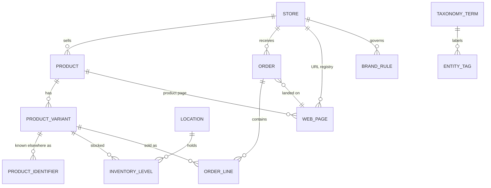
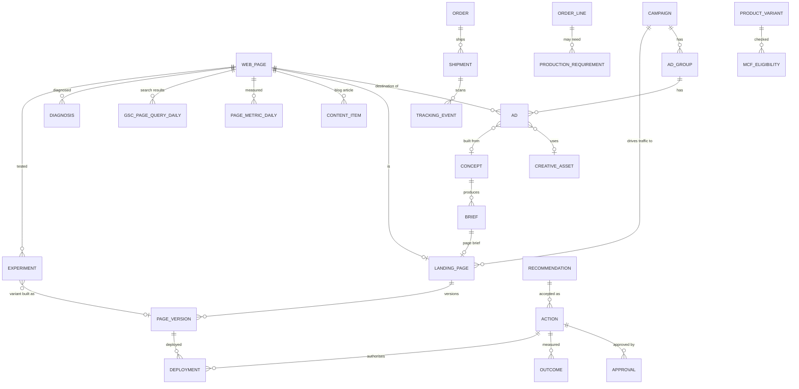

# Flowmerce: master data model

Status: planning draft v0.1, 2026-10-28. DDL: `db/schema.sql` (PostgreSQL 16, loads cleanly, smoke-tested with sample rows).

---

## 1. Schemas at a glance

| Schema | Owner | Purpose | Main tables |
|---|---|---|---|
| `auth` | platform | Users and roles | `app_user` |
| `core` | platform | **Master data shared by all modules** | `store`, `product`, `product_variant`, `product_identifier`, `product_cost`, `collection`, `location`, `inventory_level`, `customer`, `order`, `order_line`, `web_page`, `product_review_stats`, `taxonomy_term`, `entity_tag`, `brand_rule` |
| `integration` | platform | Connectors and syncing | `provider`, `connection`, `sync_job`, `sync_run`, `webhook_subscription` |
| `raw` | platform | Untouched payloads for replay | `api_payload` (partitioned), `webhook_event` |
| `ads` | Ads module | Meta + Google in one model | `ad_account`, `campaign`, `ad_group`, `ad`, `keyword`, `daily_metric`, `breakdown_metric`, `search_term_daily`, `attribution_daily`, `target`, `change_history` |
| `seo` | SEO module | Keywords to published content | `keyword_cluster`, `keyword`, `keyword_metric_daily`, `gsc_page_query_daily`, `topic`, `content_item`, `content_score`, `internal_link`, `ai_visibility_check` |
| `ship` | Shipping module | Tracking, readiness, MCF, production | `fulfillment_order`, `shipment`, `tracking_event`, `inventory_snapshot`, `mcf_eligibility`, `production_requirement`, `production_batch`, `allocation` |
| `creative` | Creative module | Ideas to briefs to tests | `asset`, `asset_product`, `concept`, `concept_asset`, `brief`, `performance_rollup`, `test_plan`, `trend_signal`, `competitor_reference` |
| `page` | Landing Page module | Brief to live page | `landing_page`, `landing_page_product`, `reference`, `page_version`, `validation_check`, `deployment` |
| `cro` | CRO module | Measure, compare, diagnose, test | `web_event` (partitioned), `page_metric_daily`, `page_attribute_snapshot`, `speed_audit`, `peer_group`, `peer_group_member`, `diagnosis`, `pattern`, `experiment` |
| `ops` | platform | Shared action engine | `event_outbox`, `event_subscription`, `alert_rule`, `alert`, `recommendation`, `approval_policy`, `action`, `approval`, `outcome`, `task`, `notification`, `audit_log`, `llm_call` |

---

## 2. Core relationships

## 3. How module tables hang off the master data

---

## 4. Identity rules (how records are matched across platforms)

| Thing | Master key | Matching rule |
|---|---|---|
| Product / variant | Shopify GID | Amazon seller SKU, ASIN, FNSKU, Meta retailer id and Google offer id are stored in `core.product_identifier`. Default match: variant SKU equals the external SKU. Mismatches go to a review queue, never auto-guessed. |
| Page | `core.web_page.url_normalized` | Lower-case host and path, query string and fragment removed, trailing slash removed, `www.` folded into the primary domain, `/collections/x/products/y` folded to `/products/y`. Ad destination URLs, GSC page URLs, ShopifyQL landing paths and pixel URLs all pass through the same normaliser. |
| Order → ad | `core.order.utm_campaign` / `utm_content` | Meta: `utm_campaign` = campaign id, `utm_content` = ad id. Google: `{campaignid}` and `{creative}`. Matched to `ads.campaign.external_id` / `ads.ad.external_id` into `ads.attribution_daily (model='utm_last_click')`. Platform-reported conversions are kept separately (`model='platform_reported'`). |
| Creative asset | `creative.asset.sha256` | The same file uploaded to Meta and Google is one asset; each ad row points to it. |
| Shipment | `(carrier, tracking_number)` | The same parcel reported by Shopify, a tracker and Amazon is merged into one `ship.shipment`. |
| Keyword | `(store, lower(text), locale)` | Semrush, Trends, GSC queries and Google keyword ideas all map to one `seo.keyword`. |
| Customer | Shopify GID + `email_sha256` | No raw email is stored. |

---

## 5. Metric definitions (one definition, used everywhere)

| Metric | Definition | Source of truth |
|---|---|---|
| Spend | Platform-reported cost in account currency | `ads.daily_metric.spend` |
| CTR (link) | link clicks / impressions | `ads.daily_metric` |
| Hook rate | 3-second video views / impressions | `ads.daily_metric` |
| Hold rate | ThruPlays / 3-second video views | `ads.daily_metric` |
| LPV | Sessions that started on the page (landing sessions) | `cro.page_metric_daily.landing_sessions` (ShopifyQL); Meta's own "landing page views" is kept separately for comparison |
| ATC rate | sessions with add-to-cart / landing sessions | `cro.page_metric_daily` |
| Checkout rate | sessions reaching checkout / landing sessions | `cro.page_metric_daily` |
| Conversion rate | purchases / landing sessions | `cro.page_metric_daily` |
| Store ROAS | UTM-attributed Shopify revenue / spend | `ads.attribution_daily` + `ads.daily_metric` |
| Platform ROAS | platform purchase value / spend | `ads.daily_metric` |
| Break-even ROAS | 1 / gross margin, with margin from `core.product_cost` | `ads.target.breakeven_value` |
| Shortfall | max(required − available, 0) | `ship.production_requirement.shortfall_qty` (generated column) |
| Stuck shipment | No tracking event for longer than the carrier/route threshold (default 72 hours) and not delivered | Rule `ship.stuck_72h` |
| Sample OK | Enough data to compare: defaults of 1,000 impressions and 50 landing sessions per variant, set per rule in config | Flag on rollups and diagnoses |

Rule: when two sources disagree (for example, Meta purchases vs Shopify orders), both are shown with their source. Neither is silently overwritten.

---

## 6. Cross-module views in the schema

| View | Joins | Used for |
|---|---|---|
| `cro.v_ad_destination_funnel` | ads.ad → core.web_page → cro.page_metric_daily | Spot ads whose clicks land on a page that does not convert. Page funnel is page-level (paid social traffic), not per ad. |
| `ship.v_ads_on_low_stock` | ads.ad.promoted_product_ids → core.product → core.inventory_level | Recommend pausing ads for products that cannot ship (make-to-order products are excluded). |
| `creative.v_term_performance_30d` | core.taxonomy_term → core.entity_tag → ads.ad → ads.daily_metric | Which hooks, angles and formats work, across every ad. |
| `core.v_product_360` | product + stock + production + ads + landing pages + SEO + CRO + reviews | One row per product with signals from every module. |

---

## 7. Data lifecycle

| Data | Retention | Notes |
|---|---|---|
| `raw.api_payload`, `raw.webhook_event`, `cro.web_event` | 13 months (monthly partitions dropped) | Enough for year-on-year replays |
| Daily metric tables | Indefinite | Small, aggregated |
| `ops.audit_log`, `ops.action`, `ops.approval` | Indefinite | Accountability |
| Page versions and code bundles | Indefinite | Rollback and history |
| LLM call logs | 13 months | Cost and quality review |

Nothing is hard-deleted by the application. Records are archived by status. Partition drops are a scheduled maintenance job reviewed by an admin.
